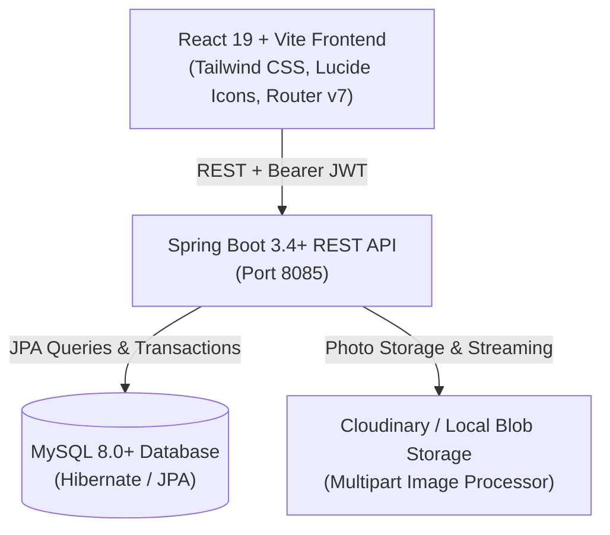

# Momento — Event Photo Sharing Platform

<div align="center">


### *Capture, share, and relive unforgettable moments together.*

[](https://www.oracle.com/java/)
[](https://spring.io/projects/spring-boot)
[](https://react.dev/)
[](https://www.typescriptlang.org/)
[](https://vitejs.dev/)
[](https://tailwindcss.com/)
[](https://www.mysql.com/)
[](LICENSE)

</div>

---

## 📖 Overview

**Momento** is a full-stack, enterprise-grade web application engineered for collaborative event photo sharing. Whether it's a wedding, birthday party, tech conference, or family reunion, Momento eliminates the frustration of fragmented messaging groups, degraded image compression, and lost memories.

Hosts can easily organize events, dispatch invitations, and manage guests. Attendees can RSVP, explore live photo feeds, upload their own high-resolution pictures with captions, and download original files seamlessly.

---

## ✨ Features

- 🔐 **Secure Authentication & Authorization**: Stateless JWT token authentication, BCrypt password hashing, and role-aware API protection.
- 📅 **Comprehensive Event Management**: Create, customize, and manage events with venue details, start/end dates, banners, and dynamic status badges (*Upcoming*, *Active*, *Concluded*).
- 📸 **High-Resolution Photo Galleries**: Upload multi-format images (JPEG, PNG, WEBP) up to 10MB with titles, descriptions, and tag support.
- 🖼️ **Interactive Lightbox Experience**: Full-screen photo viewer featuring keyboard navigation (`←`/`→`/`Esc`), zoom controls, metadata inspection, and instant download.
- ✉️ **Guest RSVP Workflow**: Invite attendees via email, track real-time response rates, and allow invitees to Accept or Decline invitations directly from their personal dashboard.
- 🛡️ **Secure Photo Streaming**: Direct blob-based media streaming via authenticated backend proxy endpoints preventing hotlinking and unauthorized exposure.
- 🎨 **Modern Tailored UI/UX**: Designed with a custom warm-peach and rose color palette (`#E83E8C`, `#FFF0F6`, `#FF8A3D`), smooth glassmorphic surfaces, responsive mobile drawers, and fluid animations.

---

## 🏗️ Architecture & Technology Stack



### Backend
- **Framework**: Spring Boot 3.4+ (Java 17/21+)
- **Security**: Spring Security 6 with stateless JWT Bearer token authentication
- **ORM / Persistence**: Spring Data JPA & Hibernate 7
- **Database Driver**: MySQL Connector/J
- **Build Tool**: Maven Wrapper (`mvnw`)
- **Port**: `8085`

### Frontend
- **Framework**: React 19 + TypeScript
- **Bundler & Tooling**: Vite 6+
- **Styling**: Tailwind CSS v3 (Custom Theme)
- **Routing**: React Router v7
- **Icons**: Lucide React
- **HTTP Client**: Native Fetch API with custom interceptor & blob image caching

---

## 📁 Repository Structure

```
event-photo-sharing/
├── backend/                             # Spring Boot Application
│   ├── src/
│   │   ├── main/
│   │   │   ├── java/com/eventshare/
│   │   │   │   ├── config/              # SecurityConfig, CorsFilter, AppConfig
│   │   │   │   ├── controller/          # REST Controllers (Auth, Event, Photo, Invitation)
│   │   │   │   ├── dto/                 # Request & Response Data Transfer Objects
│   │   │   │   ├── entity/              # JPA Entities (User, Event, Photo, Invitation)
│   │   │   │   ├── repository/          # Spring Data JPA Repositories
│   │   │   │   ├── security/            # JwtUtils, UserDetailsServiceImpl, AuthTokenFilter
│   │   │   │   └── service/             # Business Logic & Storage Handlers
│   │   │   └── resources/
│   │   │       ├── application.properties
│   │   │       └── application.properties.example
│   │   └── test/                        # Integration and Unit Tests
│   ├── mvnw
│   ├── mvnw.cmd
│   └── pom.xml
│
├── frontend/                            # React 19 + Vite Frontend
│   ├── public/
│   ├── src/
│   │   ├── components/                  # Navbar, Modals, Lightbox, AuthenticatedImage
│   │   ├── context/                     # AuthContext & Session Provider
│   │   ├── hooks/                       # Custom hooks (usePhotoUrl, etc.)
│   │   ├── lib/                         # Centralized API client & endpoint helpers
│   │   ├── pages/                       # Landing, Dashboard, Events, Details, RSVP
│   │   ├── types/                       # TypeScript interfaces and contracts
│   │   ├── App.tsx                      # Route declarations and root layout
│   │   ├── index.css                    # Tailwind design system tokens
│   │   └── main.tsx                     # React DOM entrypoint
│   ├── .env.example
│   ├── package.json
│   ├── tailwind.config.js
│   ├── tsconfig.json
│   └── vite.config.ts
│
├── .gitignore                           # Unified repository gitignore
└── README.md                            # Comprehensive project documentation
```

---

## 🔌 API Endpoints Reference

### 1. Authentication
| Method | Endpoint | Description | Auth Required |
|:---|:---|:---|:---:|
| `POST` | `/api/auth/register` | Register a new user account | ❌ No |
| `POST` | `/api/auth/login` | Authenticate and obtain JWT token | ❌ No |

### 2. Events Management
| Method | Endpoint | Description | Auth Required |
|:---|:---|:---|:---:|
| `GET` | `/api/events` | List all visible / created events | ✅ Yes |
| `POST` | `/api/events` | Create a new event | ✅ Yes |
| `GET` | `/api/events/{id}` | Get event details by ID | ✅ Yes |
| `PUT` | `/api/events/{id}` | Update existing event | ✅ Yes |
| `DELETE` | `/api/events/{id}` | Delete event | ✅ Yes |

### 3. Photos
| Method | Endpoint | Description | Auth Required |
|:---|:---|:---|:---:|
| `GET` | `/api/photos/event/{eventId}` | Get all photos uploaded for an event | ✅ Yes |
| `POST` | `/api/photos/upload/{eventId}` | Upload photo (multipart file + metadata) | ✅ Yes |
| `GET` | `/api/photos/{id}/view` | Stream raw image bytes (secure blob) | ✅ Yes |
| `GET` | `/api/photos/{id}/download` | Download full-resolution image | ✅ Yes |
| `DELETE` | `/api/photos/{id}` | Delete photo | ✅ Yes |

### 4. Invitations & RSVPs
| Method | Endpoint | Description | Auth Required |
|:---|:---|:---|:---:|
| `POST` | `/api/events/{eventId}/invitations` | Invite attendee by email | ✅ Yes |
| `GET` | `/api/events/{eventId}/invitations` | Get guest list for an event | ✅ Yes |
| `GET` | `/api/my-invitations` | Get invitations received by logged-in user | ✅ Yes |
| `PUT` | `/api/my-invitations/{id}/rsvp` | Update RSVP status (`ACCEPTED` / `DECLINED`) | ✅ Yes |

### 5. System Health
| Method | Endpoint | Description | Auth Required |
|:---|:---|:---|:---:|
| `GET` | `/api/health` | Healthcheck and server status check | ❌ No |

---

## 🚀 Getting Started

Follow the instructions below to get Momento running locally on your machine.

### Prerequisites

- **Java JDK 17** or higher
- **Node.js 18.x** or higher (with `npm` v9+)
- **MySQL Server 8.0** or higher
- **Git**

---

### Step 1: Database Setup

Log into your local MySQL server and create the application database and user:

```sql
CREATE DATABASE event_photo_sharing CHARACTER SET utf8mb4 COLLATE utf8mb4_unicode_ci;

CREATE USER 'eventshare_user'@'localhost' IDENTIFIED BY 'ChangeThis_StrongPassword_2026!';
GRANT ALL PRIVILEGES ON event_photo_sharing.* TO 'eventshare_user'@'localhost';
FLUSH PRIVILEGES;
```

---

### Step 2: Backend Configuration & Launch

1. Navigate to the backend directory:
   ```bash
   cd backend
   ```

2. Review or update your `src/main/resources/application.properties` settings:
   ```properties
   server.port=8085
   spring.datasource.url=jdbc:mysql://localhost:3306/event_photo_sharing?useSSL=false&allowPublicKeyRetrieval=true&serverTimezone=UTC
   spring.datasource.username=eventshare_user
   spring.datasource.password=ChangeThis_StrongPassword_2026!
   app.jwt.secret=EventShare_JWT_Secret_2026_Local_Development_Key_987654321
   ```

3. Run the backend using the included Maven wrapper:
   - **Linux / macOS**:
     ```bash
     ./mvnw clean spring-boot:run
     ```
   - **Windows**:
     ```powershell
     .\mvnw.cmd clean spring-boot:run
     ```

Backend server will start listening at: `http://localhost:8085`

---

### Step 3: Frontend Setup & Launch

1. Open a new terminal and navigate to the frontend directory:
   ```bash
   cd frontend
   ```

2. Install dependencies:
   ```bash
   npm install
   ```

3. Verify or create your `.env` file (copy from `.env.example`):
   ```env
   VITE_API_BASE_URL=http://localhost:8085
   ```

4. Start the Vite development server:
   ```bash
   npm run dev
   ```

5. Open your browser and navigate to:
   ```
   http://localhost:5173
   ```

---

## 🧪 Testing & Quality Assurance

### Run Backend Unit & Integration Tests
```bash
cd backend
./mvnw test
```

### Run Frontend Linting & Production Build
```bash
cd frontend
npm run build
```

---

## 🔒 Security Best Practices

- **Stateless Tokens**: Authentication tokens are verified on every incoming request via `AuthTokenFilter` without maintaining session state on the server.
- **CORS Config**: Explicit origin whitelisting configured in `SecurityConfig.java` allows local development (`http://localhost:5173`) while denying unauthorized origins in production.
- **Protected Media Delivery**: Images are served through authenticated streaming routes, validating that the requesting user has permission to view the parent event's photos.
- **File Validation**: Strict multi-part file size limits (10MB) prevent denial of service through oversized uploads.

---

## 🤝 Contributing

1. Fork the repository
2. Create your feature branch (`git checkout -b feature/AmazingFeature`)
3. Commit your changes (`git commit -m 'Add some AmazingFeature'`)
4. Push to the branch (`git push origin feature/AmazingFeature`)
5. Open a Pull Request

---

## 📄 License

This project is licensed under the MIT License — see the [LICENSE](LICENSE) file for details.

---

<div align="center">
  <sub>Built with ❤️ by <a href="https://github.com/ShivamTomar-svg">Shivam Tomar</a></sub>
</div>
